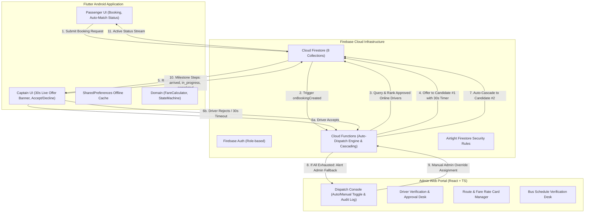
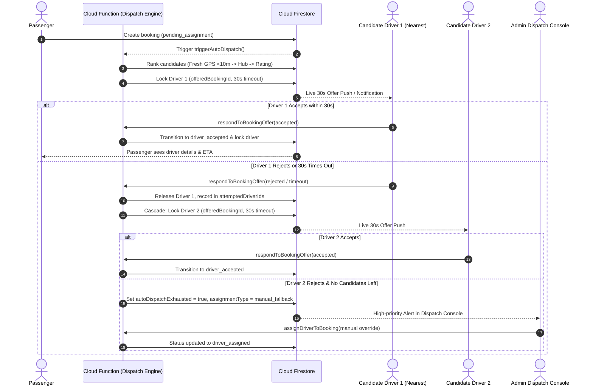
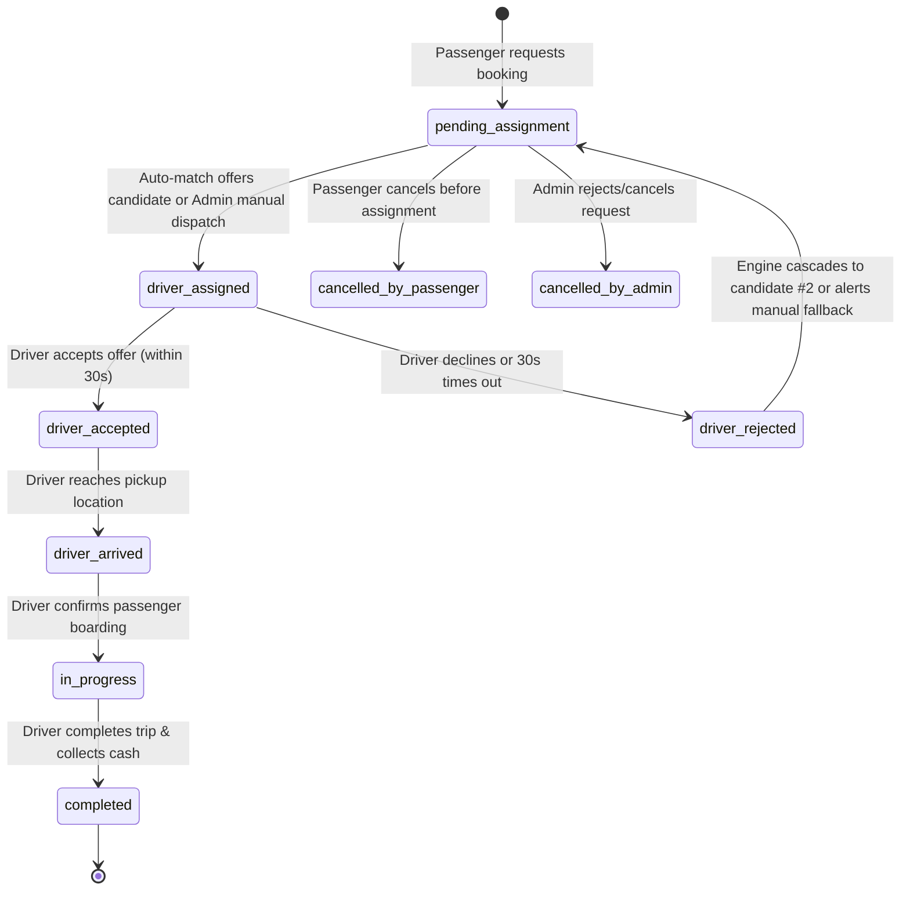

# PothikSathi — System Architecture & Technical Specification

## 1. Executive Summary
PothikSathi (পথিকসাথী) is an ultra-lightweight, resilient local mobility and public transit timetable platform engineered for semi-urban and rural West Bengal, commencing in **Karimpur, Nadia (PIN 741152)**.

The system addresses the unique operational realities of local battery-operated electric rickshaws (TOTOs) and regional bus connectivity:
- Low data bandwidth and poor intermittent connectivity.
- Fixed ₹10/seat passenger tariffs on municipal corridors without sudden surge pricing.
- Controlled whole-vehicle private reserve bookings with a ₹20 minimum floor.
- **Automatic Driver Matching as the default dispatch mode**, sequentially offering rides to the nearest eligible captain with a 30s countdown window, backed by automated cascading.
- **Configurable manual dispatch fallback and admin override** for full operational control.
- Concurrency-safe Firestore transactions preventing double-assignment or race conditions.
- Offline-capable bus timetables connecting Karimpur to Krishnanagar, Kolkata, Berhampore, and Malda.

---

## 2. Automatic Dispatch & System Architecture

---

## 3. Automatic Dispatch Sequence Diagram

---

## 4. Core Modules & Responsibilities

| Layer | Component | Description |
|---|---|---|
| **Mobile Client** | `mobile_app/lib/presentation/passenger/` | Clean green-and-white booking flow, capacity stepper, fare preview, auto-match progress, active trip status. |
| **Mobile Client** | `mobile_app/lib/presentation/driver/` | Captain dashboard, online/offline toggle, 30s countdown offer banner, accept/decline actions, milestone advancement. |
| **Mobile Client** | `mobile_app/lib/core/services/booking_service.dart` | Client-side auto-dispatch fallback simulator, 30s countdown ticker, cascade handler, real-time sync. |
| **Mobile Client** | `mobile_app/lib/presentation/timetable/` | Offline-first timetable search with verification date stamps and stale cache warning. |
| **Domain Layer** | `mobile_app/lib/domain/fare_calculator.dart` | Fixed ₹10/seat calculator, capacity enforcement (max 4), ₹20 minimum private reserve rule. |
| **Domain Layer** | `mobile_app/lib/domain/booking_state_machine.dart` | Pure state transition guard enforcing actor roles and system dispatch privileges. |
| **Security Layer** | `backend/firestore.rules` | 8-collection access enforcement, preventing self-approval, tariff tampering, and cross-driver data leaks. |
| **Backend Logic** | `backend/functions/src/autoDispatch.ts` | Candidate filtering, Haversine distance ranking (<10m fresh GPS vs hub fallback), offer locks, and cascading logic. |
| **Backend Logic** | `backend/functions/src/index.ts` | Concurrency-safe Cloud Functions: `triggerAutoDispatch`, `respondToBookingOffer`, `assignDriverToBooking`. |
| **Admin Portal** | `admin_web/src/pages/BookingManagementPage.tsx` | Master Auto/Manual toggle, live 30s offer monitor, candidate exhaustion alerts, manual override, and audit trail drawer. |

---

## 5. Milestone-Based Trip State Machine

